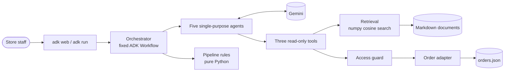
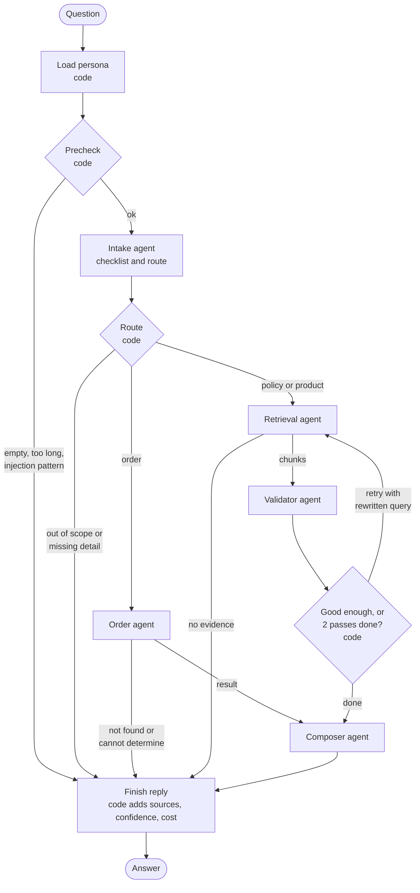
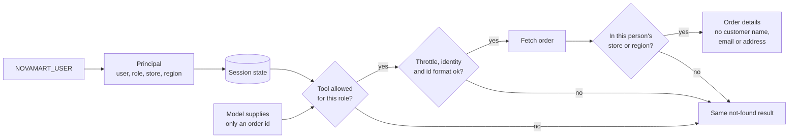

# NovaMart policy and order assistant (prototype)

An assistant for the store staff of NovaMart, a fictitious retailer. It answers policy and product questions from company documents, looks up orders within the signed-in person's own scope, says so when it does not know, and shows what each answer cost. Built with Python, Google ADK and Gemini on a free AI Studio key. It runs locally through `adk web` or `adk run`.

How this would go to production on Google's enterprise stack is in [PRODUCTION_NOTE.md](PRODUCTION_NOTE.md).

Contents: [Quick start](#quick-start) · [Architecture](#architecture) · [Key decisions](#key-decisions) · [Evaluation](#evaluation) · [With more time](#what-i-would-do-with-more-time)

## Quick start

You need Python 3.11 or newer and a free key from <https://aistudio.google.com/apikey>. Run every command from the repo root.

### 1. Install

```bash
python -m venv backend/.venv
# Windows PowerShell: backend\.venv\Scripts\Activate.ps1
# bash/zsh:           source backend/.venv/bin/activate
pip install -e "backend[dev]"
cp backend/.env.example backend/.env
```

### 2. Fill in `backend/.env`

```
GOOGLE_API_KEY=<your AI Studio key>
GOOGLE_GENAI_USE_ENTERPRISE=FALSE
GOOGLE_GENAI_USE_VERTEXAI=FALSE
NOVAMART_MODEL=gemini-3.5-flash-lite
```

- **Keep the `NOVAMART_MODEL` line.** The code default, `gemini-3.6-flash`, allowed only about 20 requests a day on the free key used here, and one question takes several requests. The lite model allowed 500.
- The two `FALSE` flags select AI Studio. Variables already set in your shell **win over `.env`**, so unset either flag there if it is `TRUE`.
- `backend/.env` is git-ignored. Never commit it. Optional settings are listed in `backend/.env.example`.

### 3. Choose who you are, then run

```bash
# bash/zsh
export NOVAMART_USER=emp_store7
adk web backend/src                  # browser UI; choose "novamart_agent"
adk run backend/src/novamart_agent   # or chat in the terminal
```

```powershell
# PowerShell
$env:NOVAMART_USER = "emp_store7"
adk web backend/src
```

| Persona (`NOVAMART_USER`) | Role | Store | Region | Orders it can see |
|---|---|---|---|---|
| `emp_store7` | employee | store-7 | north | store-7 |
| `emp_store12` | employee | store-12 | north | store-12 |
| `mgr_store7` | manager | store-7 | north | store-7 (plus manager-only documents) |
| `regmgr_north` | regional manager | none | north | stores 7 and 12 |

The persona is fixed while the process runs. To switch, stop the server and restart it with another value.

**This is not authentication.** It simulates a signed-in user so the access rules can be shown and tested. There is no password or token, so anyone who can set the variable can be anyone. Run `adk web` only on a machine you trust. With no persona, or an unknown one, every order lookup is denied.

### 4. Try it (as `emp_store7`)

| Ask | What it shows |
|---|---|
| What is the return window for electronics? | A cited answer, with the category exception |
| What is the status of order NM-480103? | An order lookup |
| Is order NM-480101 eligible for return? | A rule computed in code (see the date note below) |
| Order NM-480201? | Another store's order: reported as not found |
| What is the policy on bulk corporate orders? | A deliberate gap in the documents: the answer should say they do not cover it and give an escalation contact |

More cases with expected answers are in [TEST_CASES.md](TEST_CASES.md). Sample orders are in [backend/data/README.md](backend/data/README.md).

**Date note:** return windows are checked against today's date, but the sample orders were written for 2026-11-23. NM-480101 is returnable only through 2026-12-02. The tests and evals fix the date, so they do not drift.

The first policy search embeds the documents (one call per chunk, then cached on disk), so it is slower.

### Synthetic data only

Every document, order, customer and persona is invented. Do not enter real data: `adk web` shows the full event trace of every turn, and on the free AI Studio tier Google may use submitted content to improve its products, with human reviewers.

### Checks that need no key

```bash
ruff check backend
mypy --config-file backend/pyproject.toml backend/src
pytest backend/tests
```

## Architecture

The one rule behind the design: **the model reads and writes language; code makes the decisions.** Routing, access control, return eligibility, confidence, citations and cost are all code.

### The big picture



| Block | What it does | Code in `backend/src/novamart_agent/` |
|---|---|---|
| **Interface** | ADK's built-in browser UI or terminal chat. There is no custom UI. | `agent.py` |
| **Orchestrator** | A fixed graph that says which step runs next. No model chooses the path. | `agents/orchestrator.py` |
| **Agents** | Five narrow Gemini agents: intake, retrieval, validator, order and composer. Only retrieval and order hold tools. | `agents/`, `prompts/` |
| **Tools** | `search_policy`, `get_order_status` and `check_return_eligibility`. None writes anything, and none accepts a user, store or role. | `tools/` |
| **Retrieval** | Splits documents by heading, embeds them, drops those the role may not see, then returns the top 3 chunks scoring at least 0.6. | `rag/` |
| **Access guard** | The only route to order data. Denies by default and writes an audit record. | `security/` |
| **Order adapter** | The only code that reads orders. It stands in for NovaMart's order API. | `adapters/` |
| **Pipeline rules** | Input checks, routing, eligibility, confidence, retry limit and cost. No ADK imports, so all are testable without a key. | `pipeline/` |

### How a question is answered



| Step | What happens | Why |
|---|---|---|
| **Load persona** | Code writes the user, role and store into session state on every turn. | A message saying "I am the manager" changes nothing. |
| **Precheck** | Rejects empty messages, messages over 2,000 characters and known injection phrasings, with no model call. | Cheap first filter. It is defence in depth; the real protection is the access guard. |
| **Intake agent** | Turns the question into a short checklist of what a good answer must cover, and suggests a route. | The checklist gives the validator something concrete to check. |
| **Route** | Code maps that output to: order, policy or product, ask one question, or decline. | Predictable and testable. |
| **Order agent** | Calls the order tools. "Not found" and "cannot determine" end the turn with fixed text. | Every denial reads the same, so it never reveals that an order exists. |
| **Retrieval agent** | Searches the documents. If nothing permitted scores 0.6, the reply is fixed text with an escalation contact. | A refusal that does not depend on the model behaving. |
| **Validator agent** | Marks which checklist items the retrieved text covers, and may suggest a better search query. | A second look before answering. |
| **Retry check** | Code scores the pass and allows at most one retry. The best pass is kept, not just the last. | Bounds cost and prevents endless loops. |
| **Composer agent** | Writes the answer from the retrieved text or order record. It has no tools. | Wording is the part a model does well. |
| **Finish reply** | Code adds sources, the confidence band and the cost line. A composer diagram not found in the documents is removed. | The model cannot invent a citation. |

**Confidence** is High, Medium or Low, computed from checklist coverage (weight 0.6), the retrieval score (0.2) and the validator's own estimate (0.2). If a required checklist item is uncovered, it is always Low. A weak match still gets an answer, marked Low, with a caveat and the escalation contact.

### How order access is enforced



- **Identity comes from outside the conversation.** The model supplies an order id and nothing else, so it has no field in which to claim another identity.
- **One guard covers both order tools**, so the eligibility check cannot become a way around it.
- **Denials are identical** for a missing, out-of-scope or malformed order. After 5 denied lookups, the session is throttled.
- **Documents are filtered by role before ranking**, so employees never receive manager-only text or titles.

In production the persona is replaced by a verified sign-in token, and the order API should enforce the same scope itself ([production note](PRODUCTION_NOTE.md)).

## Key decisions

The full record, including rejected options, is in OpenSpec: [design.md](openspec/changes/novamart-rag-agent/design.md) and [decisions.md](openspec/changes/novamart-rag-agent/decisions.md). The enforced rules are in [docs/architecture.md](docs/architecture.md).

| Decision | Why | What it costs |
|---|---|---|
| **A fixed pipeline of five agents** instead of one agent with three tools | One agent could not check its own retrieval without packing every duty into one prompt. Separate steps fail, and can be tested, separately. | More model calls: 3.4 per question on average in an eval run |
| **Routing in code**, not an LLM router | A model should not choose the path, and identity handling is easier to prove | New kinds of request need code changes |
| **An ADK `Workflow` graph** | The older loop and sequence agents are deprecated in the pinned ADK version | Relies on newer behaviour, which was checked with live probes |
| **Access control in tool code**, never in prompts | The model chooses tool arguments, so a prompt rule can be argued away | Every new data tool must go through the guard |
| **One identical "not found"** for every denial | A different message would reveal that an order exists | Staff cannot tell a typo from a lack of access |
| **Hand-rolled numpy retrieval** | It exposes similarity scores for the refusal rule, and is enough for 11 documents. Managed search was excluded for this prototype. | I own chunking and indexing, and it is not built to scale |
| **Code computes return eligibility** | Date arithmetic by a model is unreliable and hard to test. The rules are read from the returns document. | Policy parameters must be kept as structured fields |
| **Two layers of refusal** | No evidence is refused in code, with no rewrite attempt; weak evidence is answered as Low confidence | The line between the two depends on a tuned threshold |
| **Code writes citations, confidence and cost** | These are the parts a user relies on to check an answer | Less flexible wording |
| **Combined order-and-policy questions take the order path only** | Kept the prototype's scope small | The reply says the policy part was not answered; ask it separately |
| **Own rule-based eval checks**, alongside `adk eval` | Content, refusal and citation checks are objective and need no model grader | They check for facts and behaviour, not writing quality |

## Evaluation

The quality set has policy, product, order, combined and refusal cases. The security set covers cross-store requests, role claims, injection (in messages and documents), manager-only content and customer data in logs. Checks are rules, not model grading. Security guarantees are also covered by unit tests that need no key. Details and every diagnosed failure: [backend/evals/RESULTS.md](backend/evals/RESULTS.md).

| Run (2026-11-24) | Model | Result |
|---|---|---|
| Quality, latest | gemini-3.1-flash-lite | 19 of 19 |
| Security, latest full run | gemini-3.5-flash-lite | 10 of 12 |

Read these with care:

- **19 of 19 is not an independent score.** Settings were tuned on these cases, and one refusal question was replaced because it scored above the retrieval threshold. Earlier full runs ranged from 12 of 18 to 17 of 19, across different settings and models, and results vary from run to run.
- **The two security failures leaked nothing.** Both questions about manager-only content got a Low-confidence answer where the case expects a refusal. Prompts changed after this run and the security set has not been rerun.
- **A similarity threshold alone is not enough.** Answerable questions scored 0.749 to 0.814 and uncovered ones 0.557 to 0.730 in a small probe, which is too close to separate reliably. Checklist coverage separated good from weak answers better, so it got more weight.
- **Not measured:** the default model, validator agreement with human labels, and a complete `adk eval` run (the daily quota ran out).

Token cost on `gemini-3.5-flash-lite` averaged about $0.88 per 1,000 questions (18 quality cases, paid list price, nothing billed).

### Run the evals (needs the key)

```bash
python backend/evals/build_evalsets.py                  # no key needed
python backend/evals/run_evals.py --dry-run             # counts calls, makes none
python backend/evals/run_evals.py --skip-adk            # quality and security sets
python backend/evals/run_evals.py                       # adds `adk eval`
python backend/evals/run_evals.py --only <case-id>
```

A full run with `adk eval` can use most of a 500-request daily quota. `--max-cases N` limits a run, and the runner stops after 3 errors in a row. Cases are in `backend/evals/cases/`; results go to `backend/evals/results/` (git-ignored).

## What I would do with more time

In priority order:

1. **Finish measuring.** Rerun the security set on the current prompts, complete `adk eval`, hand-label a sample to measure the validator, and either evaluate the default model or make the evaluated one the default.
2. **Get a score I can trust.** Add held-out questions that are never used for tuning, repeat each run to measure variation, and add more weak and borderline cases. None has yet landed in the Medium band.
3. **Improve refusals.** Resolve the cases where restricted or uncovered topics match unrelated documents, for example by refusing in code when the validator finds no checklist item covered. Then test a reranker or combined keyword and vector search.
4. **Answer combined questions in full** by running the order and policy paths and merging the results.
5. **Reduce latency and calls.** Measure time per step, then see which steps can be merged or skipped on easy questions without lowering eval results.
6. **Run independent work in parallel.** Today every step runs in sequence, with one retry loop. I would spend more time finding where agents and tool calls do not depend on each other and can run at the same time, such as a calendar call and an email call if those tools were added.
7. **Build tools for each persona.** Give different personas their own tools, each with deterministic checks in code that run before anything is passed to the model.
8. **Tidy the demo.** Make the reference date configurable and check this setup guide from a fresh clone.

Moving to production is a separate piece of work, covered in the [production note](PRODUCTION_NOTE.md).

## Cost line

Every reply ends with a line like this:

```
Cost: ~$0.0021 this answer (5 calls, 3,840 in / 410 out tokens) | session ~$0.0187 over 9 questions
```

Code computes it from reported token counts and the price table in `backend/src/novamart_agent/config.py` (override with `NOVAMART_PRICE_TABLE`). It is an estimate at paid prices, not a bill. Failed calls report no usage, so **it is a lower bound when errors occur**. A model with no listed price shows "cost unavailable". `NOVAMART_SHOW_COST=false` hides the line.

## Repository layout

```
backend/src/novamart_agent/   the agent: agents/, pipeline/, rag/, security/, tools/, adapters/, prompts/
backend/data/                 synthetic documents, orders, personas, list of deliberate gaps
backend/tests/                tests that need no key
backend/evals/                eval cases, runner and results summary
docs/                         architecture and engineering standards, review reports
openspec/                     specs, design decisions and tasks
```
